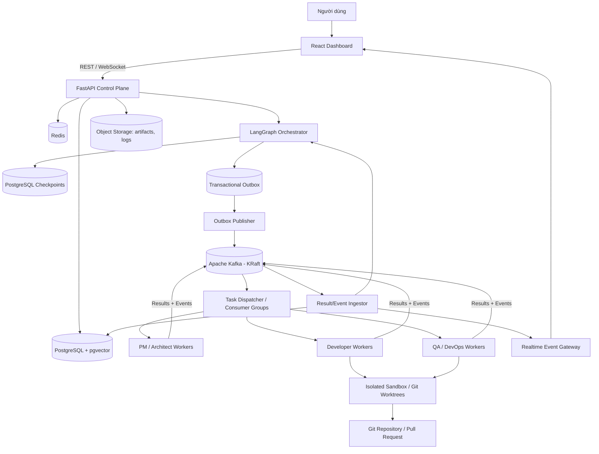
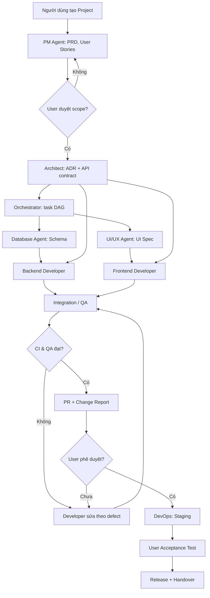

# AGENTFORGE AI — KẾ HOẠCH PHÁT TRIỂN AI SOFTWARE COMPANY

> **Phiên bản:** 1.0 — 24/10/2026  
> **Trạng thái:** Kế hoạch đề xuất, chưa triển khai  
> **Thời gian mục tiêu:** 26/10/2026 – 14/02/2027 (16 tuần)  
> **Mô hình:** Multi-Agent AI Software Company, event-driven với Apache Kafka  
> **Ngôn ngữ:** Tiếng Việt

---

## 0. Tóm tắt điều hành

**AgentForge AI** là hệ thống giúp người dùng nhập yêu cầu phần mềm dưới dạng ngôn ngữ tự nhiên; các AI Agent đóng vai các bộ phận của một công ty phát triển phần mềm để phân tích, lập kế hoạch, thiết kế, lập trình, review, kiểm thử và tạo gói bàn giao. Người dùng có thể theo dõi tiến độ, can thiệp và phê duyệt các hoạt động có rủi ro.

**Mục tiêu bản v1.0:** thực hiện thành công workflow từ yêu cầu → backlog → kiến trúc → code → test → review → tạo Pull Request → bàn giao trên ít nhất **hai dự án mẫu** (một API cơ bản và một ứng dụng full-stack nhỏ). Việc deploy production luôn cần phê duyệt của con người; bản v1.0 không cam kết AI có thể tự xây mọi loại phần mềm không cần giám sát.

**Giả định lập kế hoạch:** 2–3 thành viên, khoảng 30–40 giờ/người/tuần; có thể sử dụng AI hỗ trợ viết code; phần lớn thời gian tập trung vào hệ thống thay vì các dự án khác. Nếu chỉ một người làm bán thời gian, có thể cần 24–30 tuần hoặc lâu hơn. Ngày nêu trong tài liệu là lịch dự kiến và có thể điều chỉnh khi bắt đầu sprint.

**Nguyên tắc triển khai:**
1. Dùng **monorepo + modular architecture** để phát triển; tách deployment các worker theo nhu cầu, **không vội tạo một microservice và một database cho mỗi Agent**.
2. **LangGraph** quản lý workflow và checkpoint; **Kafka** trao đổi commands/events bất đồng bộ; **PostgreSQL** là nguồn sự thật cho task, project, approval và trạng thái nghiệp vụ.
3. Từng Agent được giới hạn tools/quyền. Code do AI sinh **chỉ chạy trong sandbox cô lập**; secrets không được đưa vào context tùy tiện.
4. Mọi tác vụ phải có trạng thái, owner, thời hạn, giới hạn retry, chi phí, audit log và cách khôi phục.
5. Ưu tiên một luồng end-to-end hoạt động trước khi tăng số Agent.

---

## 1. Phạm vi và tiêu chí thành công

### 1.1 In scope — bản v1.0

- Đăng nhập, workspace, project, RBAC tối thiểu (`owner`, `member`, `viewer`).
- Tạo project từ mô tả; đính kèm tài liệu và chỉ định repository Git.
- AI PM tạo PRD, user stories, acceptance criteria và backlog.
- AI Architect tạo thiết kế kỹ thuật, ADR, API contracts.
- Developer Agent làm việc trong Git branch/worktree riêng; tạo và chỉnh sửa file qua tools được phép.
- QA Agent đọc source, chạy unit/integration tests, phát hiện lỗi và yêu cầu sửa.
- DevOps Agent chuẩn bị Dockerfile, Compose, CI workflow; triển khai staging theo phê duyệt.
- Giao tiếp Agent↔Agent qua message/event contract có thể truy vết.
- Điều phối DAG dependencies, giới hạn concurrency, retry, cancel, resume và approval.
- Kafka KRaft cho các lệnh công việc và sự kiện hệ thống.
- Dashboard: project overview, kanban, agent activity, execution logs, message timeline, artifact/PR links, approvals.
- Báo cáo chi phí/token, traces, metrics, log, audit.
- Tài liệu triển khai, demo, kiểm thử và bàn giao.

### 1.2 Out of scope — hoãn sau v1.0

- Agent được tự ý deploy production hoặc truy cập bí mật ngoài phạm vi.
- Cho phép chạy code từ người lạ không giới hạn tài nguyên trong môi trường dùng chung.
- Tự tạo không giới hạn Agent/microservice hoặc thực hiện dự án hàng tháng mà không kiểm soát ngân sách.
- Billing thương mại đa tenant phức tạp, marketplace Agent, mobile app.
- Tự tối ưu mô hình/fine-tuning độc quyền, tự vận hành model GPU riêng.
- Bảo đảm mã AI sinh không có lỗi hoặc bảo đảm đáp ứng mọi yêu cầu kinh doanh.

### 1.3 KPI chấp nhận — mục tiêu thử nghiệm, không phải số liệu thực đo

| Nhóm | Chỉ số mục tiêu | Phương pháp đo |
|---|---|---|
| End-to-end | 2 dự án demo hoàn tất, có PR, test và hướng dẫn chạy | Acceptance test có người xác nhận |
| Workflow | ≥ 95% số workflow trong bộ 20 ca kiểm thử chuẩn đạt kết quả mong đợi hoặc lỗi được báo minh bạch | Test harness + kiểm tra thủ công |
| Task state | 100% task ghi nhận trạng thái, owner, timestamps, attempt và correlation ID | DB audit query |
| Kafka reliability | Test duplicate event không tạo hai tác động nghiệp vụ; consumer crash có thể resume | Integration / chaos test |
| Chất lượng | CI unit/integration/E2E của platform chạy xanh; không có lỗi blocker/critical chưa xử lý | CI, defect tracker |
| Security | Không có secret trong log/artifact; không có quyền thực thi host không kiểm soát | Secret scan + security review |
| Observability | Có trace xuyên suốt API → orchestration → Kafka → worker | Trace review |
| Cost | Mỗi project có budget cap, cảnh báo và tổng chi phí LLM ước tính | Usage report |
| Recovery | Task retry/cancel/resume và phê duyệt sau restart hoạt động trong bộ test | Recovery test |

> KPI hiệu năng, tải đồng thời và SLA production sẽ được chốt dựa trên benchmark thực tế ở tuần 14, tránh đưa ra cam kết thiếu dữ liệu.

---

## 2. Kiến trúc mục tiêu

### 2.1 Component diagram



### 2.2 Trách nhiệm từng thành phần

| Thành phần | Vai trò | Quyết định thiết kế |
|---|---|---|
| Frontend | Giao diện quản lý dự án, Agent, approvals | React + TypeScript + Vite |
| Control Plane | Auth, RBAC, project/task CRUD, audit, REST/WebSocket | FastAPI; duy nhất được cập nhật business state theo policies |
| Orchestrator | Chọn bước tiếp theo, phụ thuộc, checkpoint và human approval | LangGraph, bounded loops |
| Agent Runtime | Prompt, model router, context, tools, output validator | Interface chuẩn theo capability |
| Task Dispatcher | Chuyển task tới đúng loại worker, lease/quyền thực thi | Role-specific queues hoặc router rõ ràng |
| Message Backbone | Event/command log và giao tiếp phi đồng bộ | Kafka KRaft |
| Database | Source of truth: business state, lock/idempotency, outbox | PostgreSQL; migrations qua Alembic |
| Memory | Ngữ cảnh task/project, retrieval quyết định, lịch sử | PostgreSQL + pgvector; không nhét toàn bộ repo vào prompt |
| Cache | Rate limit, cache, trạng thái tạm | Redis; không là source of truth |
| Sandbox | Workspace cô lập và chạy code không tin cậy | Ephemeral container/isolated runner; tăng cường microVM khi public |
| Object Storage | Artifact, test log, report | S3-compatible hoặc local MinIO dev |
| Observability | Logs, traces, metrics, alerts, model cost | OpenTelemetry + Prometheus/Grafana |

### 2.3 Các quyết định kiến trúc (ADR)

- **ADR-001:** Monorepo là nguồn code chính; CI chia theo package/service.
- **ADR-002:** Kafka **không thay LangGraph**: Kafka vận chuyển events/commands; LangGraph lập kế hoạch và phối hợp luồng.
- **ADR-003:** PostgreSQL chứa task state; không suy ra trạng thái nghiệp vụ chỉ bằng replay Kafka.
- **ADR-004:** Mỗi thao tác side effect phải idempotent, có `idempotency_key`/`execution_id`.
- **ADR-005:** Code AI sinh chạy trong sandbox, hạn chế mạng, mount và resource; không chạy shell tự do trên API host.
- **ADR-006:** Deployment production, tạo secrets, xóa dữ liệu và các thao tác chi phí cao cần Human Approval.
- **ADR-007:** Mỗi task coding làm việc trên branch/worktree riêng; merge bằng PR + CI + review.
- **ADR-008:** Model Router cho phép thay nhà cung cấp model theo khả năng, chi phí và chính sách riêng tư.

---

## 3. Tổ chức Agent và quyền hạn

| ID | Agent | Input | Output | Công cụ được phép | Gate |
|---|---|---|---|---|---|
| A01 | Supervisor | Mục tiêu, DAG, tiến độ | Phân công/điều phối | Task, state, cost checker | Không tự sửa code |
| A02 | Project Manager | Yêu cầu người dùng | PRD, stories, backlog | Read docs, write artifacts | User duyệt scope |
| A03 | Software Architect | PRD, constraints | ADR, system design, API contract | Read repo/docs, diagram | User/tech reviewer duyệt architecture lớn |
| A04 | UI/UX Designer | User stories | Screen spec, components | Read design tokens, assets | Review UI |
| A05 | Frontend Developer | UI/API specs | React code, tests | Git edit, linter, tests trong sandbox | PR review |
| A06 | Backend Developer | API contract | API code, tests | Git edit, linter, tests trong sandbox | PR review |
| A07 | Database Engineer | Domain model | Schema, migrations | DB dev sandbox, migration tooling | Không đụng prod DB |
| A08 | QA Engineer | Code + acceptance criteria | Test cases, test results, defect list | Read repo, run test sandbox | Không sửa code production trực tiếp |
| A09 | DevOps Engineer | App + deployment policy | Docker/CI/staging manifest | CI tools, staging deploy | Approval trước deployment |

**Kích hoạt theo pha:**
- **MVP 1:** A01 (Supervisor), A06 (Developer tổng quát), A08 (Reviewer/QA).
- **MVP 2:** Thêm A02, A03 và tách Developer theo frontend/backend.
- **V1:** Hoàn thiện A04, A07, A09 và model/tool permissions.

**Không nên cho Agent tự gửi lệnh chạy chéo tự do.** Message hỏi đáp có thể đi thẳng qua conversation store; giao việc có tác động phải qua dispatcher/orchestrator để kiểm tra quyền và dependency.

---

## 4. Kafka: topic, key, schema và độ tin cậy

### 4.1 Topic đề xuất

| Topic | Producer → Consumer | Partition key | Ghi chú |
|---|---|---|---|
| `agentforge.task.commands.v1` | Orchestrator → Dispatcher | `task_id` | Dispatcher route theo `target_role`; không để tất cả Agent cùng cạnh tranh consumer group một cách mù quáng |
| `agentforge.tasks.developer.v1` | Dispatcher → Dev worker group | `task_id` | Chỉ Developer worker nhận |
| `agentforge.tasks.qa.v1` | Dispatcher → QA worker group | `task_id` | Chỉ QA worker nhận |
| `agentforge.tasks.design.v1` | Dispatcher → PM/Architect worker group | `task_id` | Nhóm design/planning |
| `agentforge.tasks.devops.v1` | Dispatcher → DevOps worker group | `task_id` | Dùng approval gate |
| `agentforge.task.results.v1` | Workers → Result ingestor | `task_id` | Output, lỗi, artifact refs |
| `agentforge.agent.messages.v1` | Agent Runtime → Agent inbox / UI | `conversation_id` | Q&A, review, feedback |
| `agentforge.domain.events.v1` | Control Plane → Dashboard/analytics | `project_id` | Task created/completed, approval requested |
| `agentforge.task.retry.v1` | Retry scheduler → Dispatcher | `task_id` | Retry sau backoff đã tính ngoài Kafka |
| `agentforge.task.dlq.v1` | Consumers → Operator | `task_id` | Quarantine, debug và manual replay |
| `agentforge.audit.v1` | Control Plane → Audit sink | `workspace_id` | Sự kiện audit đã lọc dữ liệu nhạy cảm |

> Các topic này là cấu hình mục tiêu, không nhất thiết tạo tất cả ở tuần 3. Với Kafka, ordering chỉ được bảo đảm trong cùng partition. Chọn key phù hợp với yêu cầu ordering; không dựa vào global ordering.

### 4.2 Envelope dùng chung (JSON schema versioned)

```json
{
  "event_id": "f8a0f086-cd22-4e39-a41d-73de4cdbdb61",
  "schema_version": 1,
  "event_type": "task.execute.requested",
  "occurred_at": "2026-10-26T09:00:00Z",
  "correlation_id": "project-run-001",
  "causation_id": "previous-event-id",
  "workspace_id": "ws-001",
  "project_id": "project-001",
  "task_id": "task-001",
  "execution_id": "exec-001",
  "idempotency_key": "task-001:attempt-1",
  "sender": "orchestrator",
  "recipient_role": "backend_developer",
  "attempt": 1,
  "payload": {
    "artifact_refs": ["artifact://prd/001"],
    "instructions": "Implement authentication API",
    "acceptance_criteria": ["Unit tests pass", "API contract respected"]
  }
}
```

### 4.3 Quy tắc delivery, retry và lỗi

1. **At-least-once** đối với các consumer có ghi DB hoặc gọi tool ngoại vi; luôn giả định có khả năng duplicate.
2. Consumer xử lý có giao dịch: kiểm tra event đã được xử lý → lưu trạng thái/kết quả và `processed_event_id` → commit DB → sau đó commit Kafka offset.
3. Không dùng Kafka offset làm business task status.
4. Khi tạo task + phát event: dùng **transactional outbox** trong cùng DB transaction; publisher gửi outbox lên Kafka và đánh dấu published. Vì có thể publish trùng, consumer phải idempotent.
5. Retry có exponential backoff + jitter, `max_attempts` (mặc định 3), timeout và dead-letter.
6. Với lỗi nghiệp vụ vĩnh viễn (invalid schema/permission), chuyển DLQ thay vì retry mãi.
7. Retry một thao tác shell/PR cần kiểm tra `execution_id`/external resource trước khi chạy lại, để tránh hai lần side effect.
8. Giới hạn message size; source code/log dài đưa vào object storage, Kafka chỉ mang artifact URI.
9. ACL/TLS/SASL và topic retention sẽ cấu hình cho staging/prod; dev single-node KRaft chỉ dành cho local.

### 4.4 Consumer-group routing đúng cách

- **Role-specific topics:** mỗi nhóm worker nhận topic của vai trò mình. Các replicas cùng role dùng cùng consumer group để chia tải.
- **Không** đưa các role khác nhau vào cùng consumer group của `agentforge.task.commands.v1`, vì message có thể bị giao cho consumer sai vai trò.
- Một dispatcher độc lập tiếp nhận commands và route tới topic role-specific; mỗi task chứa `target_role`, `capabilities_required` và `project_id`.
- Worker nhận task phải lease/claim task trong PostgreSQL trước khi tạo side effects; tránh chạy trùng do redelivery/rebalance.

---

## 5. Workflow nghiệp vụ chuẩn

### 5.1 Workflow end-to-end



### 5.2 Trạng thái task

- `draft` → `ready` → `claimed` → `running` → `in_review` → `completed`.
- Nhánh xử lý: `blocked`, `awaiting_approval`, `retry_scheduled`, `failed`, `cancelled`.
- Mỗi chuyển trạng thái được kiểm tra bằng state machine; `completed` chỉ sau acceptance check và review bắt buộc.
- Dependency DAG không được có cycle. Task `ready` khi mọi dependency cần thiết đã `completed`.
- Một task có thể gắn `parent_task_id`, `required_artifacts`, `acceptance_criteria`, `budget_cap`, `lease_expiry`.

### 5.3 Kiểm soát vòng lặp

- `max_review_loops = 3` cho mỗi task coding (configurable).
- `max_execution_minutes` theo loại task; `max_tokens` / `max_cost_usd` cho mỗi project/run.
- Nếu vượt limit → trạng thái `blocked` hoặc `awaiting_approval`, không tự động tăng ngân sách.
- Dừng toàn project khi người dùng bấm Stop; ngừng phát task mới, yêu cầu worker đang chạy cancel an toàn.

---

## 6. Data model và API

### 6.1 Các bảng chính

| Bảng | Trường quan trọng (gợi ý) | Ghi chú |
|---|---|---|
| `users` | `id`, `email`, `password_hash`/external_id | Auth |
| `workspaces` | `id`, `name`, `owner_id` | Data boundary |
| `workspace_members` | `workspace_id`, `user_id`, `role` | RBAC |
| `projects` | `id`, `workspace_id`, `name`, `status`, `repo_url` | Project |
| `project_requirements` | `id`, `project_id`, `version`, `content_ref` | PRD version |
| `agents` | `id`, `role`, `model_profile`, `tool_policy` | Agent config |
| `tasks` | `id`, `project_id`, `role`, `status`, `priority`, `lease_owner`, `attempts` | Business state |
| `task_dependencies` | `task_id`, `depends_on_task_id` | DAG |
| `workflow_runs` | `id`, `project_id`, `checkpoint_thread_id`, `status` | Orchestration |
| `agent_messages` | `id`, `conversation_id`, `from_agent`, `to_agent`, `payload_ref` | Agent chat |
| `artifacts` | `id`, `project_id`, `task_id`, `kind`, `uri`, `checksum` | Source/report refs |
| `executions` | `id`, `task_id`, `sandbox_id`, `exit_code`, `logs_uri` | Execution |
| `approvals` | `id`, `project_id`, `action`, `status`, `reviewed_by` | Human gate |
| `llm_usage` | `id`, `agent_id`, `task_id`, `model`, `input_tokens`, `output_tokens`, `estimated_cost` | Cost |
| `outbox_events` | `id`, `event_type`, `payload`, `published_at` | Reliable publish |
| `processed_events` | `consumer_name`, `event_id`, `processed_at` | Idempotency |
| `audit_logs` | `id`, `actor`, `action`, `resource`, `metadata`, `created_at` | Audit |
| `memory_chunks` | `id`, `project_id`, `source_ref`, `embedding`, `content` | Retrieval |

Chỉ mục và ràng buộc quan trọng: unique `(consumer_name, event_id)`; foreign keys theo workspace/project; index `(project_id, status)`; index cho `task_dependencies`; index/vector index phù hợp với quy mô corpus; cấm cross-tenant query qua RBAC/scoping.

### 6.2 REST API MVP

```text
POST   /api/v1/auth/login
GET    /api/v1/me
POST   /api/v1/projects
GET    /api/v1/projects
GET    /api/v1/projects/{project_id}
POST   /api/v1/projects/{project_id}/requirements
POST   /api/v1/projects/{project_id}/runs
GET    /api/v1/projects/{project_id}/runs
POST   /api/v1/runs/{run_id}/cancel
POST   /api/v1/runs/{run_id}/resume
GET    /api/v1/projects/{project_id}/tasks
GET    /api/v1/tasks/{task_id}
GET    /api/v1/tasks/{task_id}/messages
GET    /api/v1/projects/{project_id}/artifacts
GET    /api/v1/projects/{project_id}/usage
GET    /api/v1/approvals?status=pending
POST   /api/v1/approvals/{approval_id}/decision
GET    /api/v1/agents
WS     /api/v1/ws/projects/{project_id}
```

**Quy tắc API:** JWT/OIDC theo cấu hình, validation Pydantic, workspace scoping, pagination, request IDs, rate limit, OpenAPI contract, mã lỗi nhất quán; các endpoint gây side effect nên hỗ trợ `Idempotency-Key` khi phù hợp.

### 6.3 Realtime event payload

```json
{
  "type": "task.status.changed",
  "project_id": "project-001",
  "task_id": "task-001",
  "status": "in_review",
  "timestamp": "2026-11-18T10:00:00Z"
}
```

WebSocket phục vụ UI, **không** là hệ thống lưu trữ trạng thái chính. Sau reconnect, UI fetch snapshot qua REST và dùng event stream cập nhật tiếp.

---

## 7. Cấu trúc source code mục tiêu

```text
agentforge-ai/
├── apps/
│   ├── web/                          # React/TypeScript/Vite
│   │   ├── src/
│   │   │   ├── app/                  # Routing, providers
│   │   │   ├── features/
│   │   │   │   ├── auth/
│   │   │   │   ├── projects/
│   │   │   │   ├── agent-monitor/
│   │   │   │   ├── task-board/
│   │   │   │   ├── chat/
│   │   │   │   ├── artifacts/
│   │   │   │   └── approvals/
│   │   │   ├── components/
│   │   │   ├── lib/api-client/
│   │   │   └── stores/
│   │   ├── tests/
│   │   └── package.json
│   └── api/
│       ├── app/
│       │   ├── main.py
│       │   ├── api/v1/
│       │   ├── core/                 # Settings, auth, RBAC
│       │   ├── db/                   # SQLAlchemy, migrations
│       │   ├── models/
│       │   ├── schemas/
│       │   ├── repositories/
│       │   ├── services/
│       │   └── websocket/
│       └── tests/
├── packages/
│   ├── agent_core/
│   │   ├── interfaces.py
│   │   ├── base_agent.py
│   │   ├── registry.py
│   │   ├── model_router.py
│   │   ├── tool_policies.py
│   │   └── prompts/
│   ├── agents/
│   │   ├── supervisor/
│   │   ├── project_manager/
│   │   ├── architect/
│   │   ├── ui_ux/
│   │   ├── frontend/
│   │   ├── backend/
│   │   ├── database/
│   │   ├── qa/
│   │   └── devops/
│   ├── orchestration/
│   │   ├── state.py
│   │   ├── graph.py
│   │   ├── planner.py
│   │   ├── dag_scheduler.py
│   │   ├── checkpoints.py
│   │   └── approval_nodes.py
│   ├── communication/
│   │   ├── contracts/
│   │   ├── kafka_producer.py
│   │   ├── kafka_consumer.py
│   │   ├── dispatcher.py
│   │   ├── topic_registry.py
│   │   ├── outbox_publisher.py
│   │   ├── idempotency.py
│   │   └── retry_policy.py
│   ├── memory/
│   │   ├── context_builder.py
│   │   ├── repository_indexer.py
│   │   └── retrieval.py
│   ├── execution/
│   │   ├── sandbox_manager.py
│   │   ├── git_worktree.py
│   │   ├── tool_runner.py
│   │   ├── test_runner.py
│   │   └── artifact_store.py
│   └── common/
│       ├── logging.py
│       ├── tracing.py
│       └── exceptions.py
├── workers/
│   ├── agent_worker/
│   ├── dispatcher_worker/
│   ├── result_ingestor/
│   ├── execution_worker/
│   └── outbox_worker/
├── infra/
│   ├── compose.dev.yaml
│   ├── compose.staging.yaml
│   ├── kafka/
│   ├── postgres/
│   ├── observability/
│   └── terraform/                 # Khi cần cloud production
├── scripts/
│   ├── bootstrap.sh
│   ├── bootstrap.ps1
│   ├── create_topics.py
│   └── seed_demo.py
├── tests/
│   ├── contract/
│   ├── integration/
│   ├── workflows/
│   ├── security/
│   ├── chaos/
│   └── e2e/
├── docs/
│   ├── product/
│   ├── architecture/
│   ├── adr/
│   ├── runbooks/
│   └── handover/
├── .github/workflows/
├── .env.example
├── pyproject.toml
├── package.json
├── README.md
└── LICENSE
```

**MVP tuần 1–6:** có thể gộp `agent_worker`, `dispatcher_worker`, `result_ingestor` vào một process/ít container hơn để dễ debug; giữ interface/module boundary để tách sau.

---

## 8. Lịch 16 tuần — công việc, đầu ra, nghiệm thu

> Sprint = 1 tuần. Mỗi tuần có planning, daily ngắn, demo, review và cập nhật rủi ro. Khi trễ, bảo vệ acceptance gate của MVP thay vì cố thêm Agent mới.

### Giai đoạn 1 — Phân tích và thiết kế (Tuần 1–2)

#### Tuần 1 — 26/10–01/11/2026: Khởi động

**Mục tiêu:** chốt bài toán và cách đo thành công.

- [ ] Kickoff; thống nhất owner, thành viên, trách nhiệm, quy ước báo cáo.
- [ ] Viết Vision, problem statement, personas, user journey.
- [ ] Chốt MVP vs post-MVP, các giả định và giới hạn autonomy.
- [ ] Viết 10–15 use cases, 20 acceptance scenarios, 2 dự án demo.
- [ ] Xây product backlog ưu tiên MoSCoW, task dependencies, risk register.
- [ ] Tạo GitHub repo, board, labels, PR/issue templates, branch protection.
- [ ] Thiết lập code style, CI skeleton, ADR template, conventions.

**Deliverables:** `docs/product/vision.md`, `prd-v1.md`, `use-cases.md`, `backlog.md`, `risk-register.md`, GitHub repo.

**Gate W1:** PRD v0.1 được người phụ trách chấp nhận; không có yêu cầu MVP mâu thuẫn.

#### Tuần 2 — 02/11–08/11/2026: Thiết kế kiến trúc

- [ ] Kiến trúc C4 Context/Container/Component, sequence các luồng chính.
- [ ] Chốt boundary API / orchestration / agents / workers / sandbox.
- [ ] Thiết kế database ERD, Kafka topics, event versioning, retry, DLQ.
- [ ] Viết ADR (Kafka vs queue, model router, state ownership, sandbox).
- [ ] Phân tích threat model, RBAC, approval matrix.
- [ ] Thiết kế wireframes: Dashboard, Project, Agent Activity, Task Board, Approval.
- [ ] Xây test strategy và performance measurement plan.

**Deliverables:** `architecture.md`, `ERD`, `event-contracts.md`, `threat-model.md`, `wireframes`, ADRs.

**Gate W2:** một task có thể được truy vết từ request đến worker và kết quả trên sơ đồ; phương án lưu business state rõ ràng.

### Giai đoạn 2 — Hạ tầng cốt lõi (Tuần 3–4)

#### Tuần 3 — 09/11–15/11/2026: Bootstrap backend và data

- [ ] Khởi tạo Python environment, FastAPI, SQLAlchemy, Alembic, Pydantic.
- [ ] PostgreSQL + pgvector, Redis, Kafka KRaft single-node **cho local dev**.
- [ ] Health checks, migrations, seed, `.env.example` không chứa secrets.
- [ ] Viết schemas: projects, tasks, approvals, agent_messages, outbox, processed_events.
- [ ] Auth + RBAC tối thiểu, tenant/workspace scoping.
- [ ] CI lint/unit check, logging có correlation IDs.

**Deliverables:** backend boot được, `compose.dev.yaml`, migrations, OpenAPI docs, CI cơ bản.

**Gate W3:** `docker compose up`/các lệnh bootstrap tương đương chạy được trên máy mới; tests xanh.

#### Tuần 4 — 16/11–22/11/2026: Kafka foundation

- [ ] Producer/consumer async, Pydantic event contract, schema version.
- [ ] Dispatcher + role-specific topics tối thiểu: commands/developer/qa/results/events/DLQ.
- [ ] PostgreSQL outbox + publisher.
- [ ] Consumer idempotency, manual offset commit sau DB transaction.
- [ ] Retry bounded + DLQ, metrics lag, event tracing.
- [ ] Integration test: duplicate, rebalance, worker crash, invalid schema.

**Deliverables:** một task giả có thể đi API → DB/outbox → Kafka → worker → DB → UI/event; có audit và kết quả.

**Gate W4:** gửi duplicate không thực hiện nghiệp vụ hai lần; kill worker rồi restart vẫn xử lý an toàn.

### Giai đoạn 3 — Multi-Agent Core (Tuần 5–6)

#### Tuần 5 — 23/11–29/11/2026: Agent Runtime + LangGraph

- [ ] `BaseAgent`, `AgentRegistry`, `ModelRouter`, tool permissions.
- [ ] Prompt/version management và structured outputs.
- [ ] LangGraph state machine, Postgres checkpoint.
- [ ] Supervisor + General Developer + Reviewer agents (MVP 3 Agent).
- [ ] Tool budget/token budget, timeouts, retry loops, cancellation.
- [ ] Unit tests cho routing, state transitions và invalid model outputs.

**Deliverables:** flow ba Agent chạy trên simulated tools, có checkpoint/resume.

**Gate W5:** dừng giữa workflow rồi khôi phục không lặp tác vụ có side effect.

#### Tuần 6 — 30/11–06/12/2026: Planning, Architect và DAG

- [ ] Project Manager Agent: chuyển mô tả thành PRD và tasks.
- [ ] Architect Agent: kiến trúc, interfaces, dependencies.
- [ ] Task DAG scheduler, validation cycle/depends-on.
- [ ] Human approval cho scope/architecture; pause/resume.
- [ ] Message conversation + artifact refs; tóm tắt context theo task.
- [ ] Demo workflow yêu cầu → PRD → architecture → backlog.

**Deliverables:** PRD, technical design, tasks được lưu/version; người dùng chấp thuận mới tiếp tục.

**Gate W6:** ít nhất 3 kịch bản planning có thể chấp thuận, từ chối, yêu cầu sửa và resume đúng trạng thái.

### Giai đoạn 4 — Coding & QA (Tuần 7–9)

#### Tuần 7 — 07/12–13/12/2026: Git workspace và sandbox

- [ ] Clone repo đích qua quyền scoped token, branch/worktree theo task.
- [ ] Tool đọc file, tìm kiếm, sửa file theo allowlist, ghi diff.
- [ ] Sandbox ephemeral; hạn chế CPU/RAM/thời gian/FS/network.
- [ ] Chặn đường dẫn ngoài workspace, symlink escapes, secret exposure.
- [ ] Runner cho `pytest`, lint, npm test theo project template.
- [ ] Lưu execution logs/artifacts ngoài Kafka, có checksum.

**Deliverables:** Developer Agent có thể tạo một thay đổi nhỏ + tests trên sample repo **chỉ trong sandbox**.

**Gate W7:** thử lệnh nguy hiểm/đường dẫn ngoài scope bị từ chối; artifact và diff truy xuất được.

#### Tuần 8 — 14/12–20/12/2026: Developer thực chiến

- [ ] Backend Developer: API implementation từ contract.
- [ ] Frontend Developer: UI component từ design spec.
- [ ] Database Engineer: migrations và schema review trên DB dev.
- [ ] Chia task theo dependency và giao branch riêng, tránh write conflict.
- [ ] Tạo commit/PR tự động, link PR vào task.
- [ ] Review API contract và merge policy.

**Deliverables:** demo API CRUD hoặc auth mẫu có PR, tests; frontend view mẫu đọc API.

**Gate W8:** các task độc lập chạy song song, không ghi đè file nhau; PR review được trên GitHub.

#### Tuần 9 — 21/12–27/12/2026: QA và repair loop

- [ ] QA Agent tạo test cases từ acceptance criteria.
- [ ] Chạy unit/integration tests, gom lỗi và gán severity.
- [ ] QA → Developer feedback → fix → retest tối đa 3 vòng.
- [ ] Static checks/secret scanning/SBOM theo khả năng.
- [ ] Phân loại blocker, flaky test, model errors, infra errors.
- [ ] Tạo change report: files, test summary, known limitations.

**Deliverables:** yêu cầu mẫu đi từ issue → PR → QA pass hoặc fail minh bạch.

**Gate W9 — MVP Feature Complete:** hoàn thành một vòng build/test/review tự động có human oversight.

### Giai đoạn 5 — Dashboard và cộng tác (Tuần 10–11)

#### Tuần 10 — 28/12/2026–03/01/2027: Dashboard

- [ ] Login, project list/create/view, project requirement editor.
- [ ] Kanban board task, dependency details, run history.
- [ ] Agent directory, role/capability/status.
- [ ] REST query, pagination, loading/error/empty states.
- [ ] Frontend component tests và responsive layout.

**Deliverables:** dashboard dùng được để khởi tạo, xem và quản lý project.

**Gate W10:** người dùng không cần gọi curl để xem trạng thái task/project.

#### Tuần 11 — 04/01–10/01/2027: Realtime + Approvals

- [ ] WebSocket event gateway và reconnect/refetch state.
- [ ] Agent conversation timeline, message filters và tool activity.
- [ ] Approval queue: accept/reject/request changes có audit.
- [ ] Cost/token charts, run cancel/pause/resume từ UI.
- [ ] E2E UI flow từ tạo dự án đến duyệt PR.

**Deliverables:** demo luồng công việc với UI realtime + phê duyệt.

**Gate W11:** mất WebSocket/reload trang vẫn khôi phục đúng trạng thái từ server.

### Giai đoạn 6 — Hoàn thiện công ty AI (Tuần 12–13)

#### Tuần 12 — 11/01–17/01/2027: Bộ nhớ và model routing

- [ ] Project memory: decisions, architecture, existing code, issue history.
- [ ] Retrieval scoped theo project/workspace; chunking và indexing.
- [ ] Prompt/context compression, avoid overlong context.
- [ ] Model profiles theo Agent, fallback có kiểm soát.
- [ ] Token/cost budgets, estimate, provider error handling.
- [ ] Tests chống truy xuất dữ liệu project khác.

**Deliverables:** Agent có thể dùng thông tin kiến trúc đã duyệt ở các task sau; usage report đầy đủ.

**Gate W12:** truy xuất context đúng quyền; model failure không làm mất task state.

#### Tuần 13 — 18/01–24/01/2027: DevOps, staging, hardening

- [ ] DevOps Agent tạo Dockerfile, Compose, GitHub Actions template.
- [ ] Staging deployment theo approval.
- [ ] Quản lý secrets qua secret manager/env injection, không lưu plain text.
- [ ] RBAC checks, input sanitation, prompt injection threat scenarios.
- [ ] Audit logs, metrics dashboards, alert rules và basic backups.
- [ ] Kiểm thử demo app full-stack #2 từ yêu cầu đến staging.

**Deliverables:** staging chạy được, deployment runbook, approval có hiệu lực.

**Gate W13 — Feature Freeze:** không thêm feature mới sau gate trừ lỗi blocker/security.

### Giai đoạn 7 — Kiểm thử và ổn định (Tuần 14–15)

#### Tuần 14 — 25/01–31/01/2027: Validation toàn diện

- [ ] Unit, integration, contract, E2E, smoke tests.
- [ ] Kafka duplicate, dropped connection, consumer rebalance, broker restart.
- [ ] Database checkpoint/recovery, outbox backlog, task lease expiry.
- [ ] Load tests có điều kiện: 5/10/20 concurrent tasks và throughput đo được.
- [ ] Sandbox breakout/threat scenarios, secret scanning, auth/RBAC test.
- [ ] Chi phí AI: đánh giá giới hạn budget với demo benchmark.
- [ ] Accessibility/basic responsive tests và UX walk-through.

**Deliverables:** test evidence, benchmark report, lỗi được triage, tài liệu hạn chế.

**Gate W14:** không còn blocker/critical chưa giải quyết; nêu rõ số liệu thực đo và môi trường test.

#### Tuần 15 — 01/02–07/02/2027: UAT và release candidate

- [ ] User Acceptance Test trên 2 demo projects độc lập.
- [ ] Kiểm tra onboarding từ máy sạch và khả năng setup lặp lại.
- [ ] Kiểm tra DB migrations, backup và restore staging.
- [ ] Chốt security, ops, cost controls; cập nhật threat model.
- [ ] Release candidate tag (`v1.0.0-rc1`), changelog, demo scripts.
- [ ] Viết user guide, API guide, operations runbook và troubleshooting.

**Deliverables:** release candidate có hướng dẫn chạy, kịch bản demo, báo cáo UAT.

**Gate W15:** người nghiệm thu đồng ý các acceptance criteria hoặc lập danh sách ngoại lệ đã phê duyệt.

### Giai đoạn 8 — Bàn giao (Tuần 16)

#### Tuần 16 — 08/02–14/02/2027: Release và handover

- [ ] Release `v1.0.0` theo semantic versioning; deploy staging/demo hoặc môi trường đã thống nhất.
- [ ] Demo từ nhập yêu cầu tới PR + test report + approval + staging.
- [ ] Bàn giao source code, database migrations, `.env.example`, OpenAPI docs.
- [ ] Bàn giao Docker/CI, setup guide, runbook, backup/restore.
- [ ] Bàn giao threat model, test report, known limitations, usage/cost report.
- [ ] Kiểm tra toàn bộ secrets, rotation và quyền truy cập trước bàn giao.
- [ ] Postmortem, lessons learned, backlog v1.1, roadmap 90 ngày.

**Deliverables:** release package + tài liệu + demo video (tùy lựa chọn) + biên bản nghiệm thu.

**Gate W16 — Done:** đáp ứng Definition of Done và danh sách release acceptance ở mục 12.

---

## 9. Phân công nhân sự (khuyến nghị nhóm 3 người)

| Vai trò | Thành viên A (Platform/AI) | Thành viên B (Backend/Data/Kafka) | Thành viên C (Frontend/QA/DevOps) |
|---|---|---|---|
| W1–W2 | PRD và agent flow | Architecture/API/data/events | UX/prototyping và test strategy |
| W3–W4 | Agent contracts, orchestration skeleton | FastAPI, DB, Kafka/outbox | Compose, auth UI, CI |
| W5–W6 | LangGraph, PM, Architect | Task DAG, checkpoint DB, APIs | UI skeleton, automated tests |
| W7–W9 | Dev Agent, model/tool routing | Sandbox/Git, QA interface | Integration/E2E tests, PR workflow |
| W10–W11 | Agent message timeline | WebSocket/approval APIs | Dashboard/approval UI |
| W12–W13 | Memory/model routing | Security/RBAC/observability | Staging, DevOps, docs |
| W14–W16 | LLM eval, fixes | Kafka recovery/performance | QA/UAT/release/demo |

- **Code owner:** module owner bắt buộc approve PR chứa thay đổi quan trọng.
- **Weekly review:** một thành viên trình bày demo, một người test theo kịch bản, một người rà rủi ro/cost.
- **Single-developer mode:** ưu tiên W1–W9, W10–W11; giảm scope memory nâng cao/DevOps để không trễ demo.

---

## 10. Quản lý dự án, Git và CI/CD

### 10.1 Branch strategy

```text
main                     # protected, release-ready
feature/<ticket>-<slug>  # human development
agent/<project>/<task>   # agent-generated worktree/branch
fix/<ticket>-<slug>
release/v1.0.0
```

- Mọi Agent code thay đổi qua branch và Pull Request; không push thẳng `main`.
- Pull Request có diff summary, issue/task link, test results, estimated cost, reviewer.
- CI bắt buộc: formatter, lint, type checks, unit tests, contract tests, security scan và integration tests phù hợp.
- Không tự động merge nếu chưa đạt CI/approval gate.

### 10.2 Một sprint tuần

| Ngày | Hoạt động |
|---|---|
| Thứ Hai | Planning, scope commit, phân công và chốt acceptance |
| Thứ Ba–Năm | Development, code review, integration |
| Thứ Sáu | Demo, test evidence, bug triage |
| Cuối tuần nếu cần | Buffer, documentation, retrospective; không coi là bắt buộc |

**Definition of Ready:** có mô tả rõ, acceptance criteria, dependencies, owner, test approach, security impact.  
**Definition of Done:** code đã review, CI xanh, migration/update docs nếu có, logs/metrics hợp lý, không hardcode secret, demo đạt acceptance, issue và PR được liên kết.

### 10.3 Board labels

- Type: `feature`, `bug`, `security`, `infra`, `docs`, `test`, `research`.
- Priority: `P0`, `P1`, `P2`, `P3`.
- Component: `frontend`, `api`, `orchestrator`, `agents`, `kafka`, `sandbox`, `memory`, `devops`.
- Status: `backlog`, `ready`, `in-progress`, `blocked`, `review`, `done`.

---

## 11. Kiểm thử, an toàn và vận hành

### 11.1 Test matrix

| Tầng | Ví dụ | Tần suất |
|---|---|---|
| Unit | DAG scheduler, state machine, Pydantic schema, RBAC functions | Mỗi PR |
| Contract | API/OpenAPI, Kafka event schema evolution | Mỗi PR |
| Integration | Kafka → DB, outbox → publisher, task → worker, Redis cache | Mỗi PR / nightly |
| Workflow | Plan/code/review/resume/cancel, approval waits | Nightly |
| E2E | Create project → generate → PR → QA → approve | Nightly / release |
| Chaos | Kill worker, duplicate event, broker restart, expired lease | W14 + định kỳ |
| Security | Prompt injection, sandbox escape attempts, secret exfil, IDOR | W7, W13–14 |
| Performance | Nhiều Agent runs, Kafka lag, DB p95, WebSocket reconnect | W14 |
| Model eval | PRD correctness, code buildability, test-fix loop, hallucinated tools | W6, W9, W14 |

### 11.2 Sandbox policy tối thiểu

- Chạy mỗi job trong môi trường mới/ephemeral; user không có quyền root trên host.
- Resource quotas CPU/RAM/storage/time; xóa môi trường sau khi hoàn tất.
- Chỉ mount workspace cần thiết; filesystem read-only nơi phù hợp; chặn quyền Docker daemon socket.
- Egress network deny-by-default; chỉ cho domain cần thiết theo policy.
- Secret injection ngắn hạn và scoped; sanitize logs.
- Không xem Docker container đơn thuần là boundary đủ mạnh cho môi trường multi-tenant không tin cậy; đánh giá microVM/gVisor/Kata/managed isolated runners khi public.
- Có nút stop/cancel và khả năng thu hồi token/quyền.

### 11.3 Các rủi ro chính

| ID | Rủi ro | Mức độ | Biện pháp |
|---|---|---|---|
| R1 | Agent lặp vô hạn, đốt token | Cao | Budget caps, timeouts, max loops, human gate |
| R2 | Kafka duplicate dẫn đến chạy tool 2 lần | Cao | Idempotency + task lease + outbox + offset control |
| R3 | AI code gây lỗi/bảo mật | Cao | Tests, static scans, PR review, sandbox |
| R4 | Prompt injection qua README/issue/source code | Cao | Treat retrieved content as untrusted, tool permissions, approval |
| R5 | Agent ghi đè thay đổi của nhau | Trung bình/Cao | Git worktrees, PR merge policies, dependency locks |
| R6 | Dữ liệu user/secret bị gửi sang model ngoài | Cao | Data classification, redaction, provider policy, secrets isolation |
| R7 | Thiếu tài nguyên chạy Kafka + sandbox local | Trung bình | Giảm replicas, giới hạn concurrent jobs, dùng staging cloud khi cần |
| R8 | Trễ tiến độ vì scope quá lớn | Cao | Gate theo tuần, tính năng ưu tiên, freeze W13 |
| R9 | Mất state khi crash | Cao | Persistent checkpoints, PostgreSQL backup, recovery tests |
| R10 | Agent được cấp quyền cao hơn cần thiết | Cao | RBAC, capability scopes, approval matrix, audit |
| R11 | Thay đổi API của model/framework | Trung bình | Pin dependencies, model adapter, integration tests |

### 11.4 Observability & alerting

**Metrics:** `tasks_total`, `task_duration_seconds`, `task_failures`, `kafka_consumer_lag`, `outbox_pending`, `sandbox_failures`, `llm_tokens`, `estimated_llm_cost`, `approval_wait_time`.

**Trace fields:** `trace_id`, `correlation_id`, `project_id`, `task_id`, `agent_role`, `model`, `workflow_run_id`, `execution_id`; không log raw secrets và PII không cần thiết.

**Cảnh báo:** tăng DLQ, outbox backlog, worker crash loop, token budget 80%/100%, DB error, sandbox policy violation, long-running task, approval quá hạn.

---

## 12. Checklist nghiệm thu release v1.0

### 12.1 Product

- [ ] Tạo workspace, project và yêu cầu phần mềm qua dashboard.
- [ ] PM tạo PRD/backlog; Architect tạo kiến trúc và contracts.
- [ ] Người dùng review/chấp thuận các checkpoint quan trọng.
- [ ] Orchestrator phân chia task có dependencies, ghi state bền vững.
- [ ] Các Agent trao đổi message/task result với correlation ID.
- [ ] Developer viết code trong sandbox/worktree riêng và tạo PR.
- [ ] QA chạy test, phản hồi bug, Developer fix với giới hạn vòng lặp.
- [ ] DevOps chuẩn bị staging và chờ phê duyệt.
- [ ] Dashboard realtime, artifact links, cost report hoạt động.
- [ ] Hai dự án demo có thể dựng lại từ hướng dẫn.

### 12.2 Engineering / Operations

- [ ] CI xanh; migration up/down được kiểm tra.
- [ ] Event schema được version; idempotency, retry, DLQ hoạt động.
- [ ] Worker crash/restart không làm mất trạng thái hoặc chạy side effect lặp không kiểm soát.
- [ ] Auth/RBAC/project isolation được test.
- [ ] Sandbox limits, secret scanning, approvals được test.
- [ ] Backup/restore staging thành công.
- [ ] Có docs architecture, API, setup, operations, incident recovery.
- [ ] Có changelog, version tag, known issues và roadmap tiếp theo.

### 12.3 Bàn giao

- [ ] GitHub repository + license + README.
- [ ] `.env.example` (không chứa secrets), Compose/dev bootstrap.
- [ ] DB migrations + seed/demo dataset.
- [ ] Kafka topic definition + event contracts.
- [ ] Sample project, sample workflow runs, dashboard screenshots/demo.
- [ ] Test report + security review + benchmark report.
- [ ] User manual + developer guide + ops runbook.
- [ ] Danh sách tài khoản và quyền truy cập đã rà soát, secrets đã luân chuyển khi cần.

---

## 13. Ngân sách và tài nguyên

### 13.1 Thành phần chi phí

1. **LLM API:** phí theo token/model, chiếm tỷ trọng biến động mạnh; tránh đoán giá cố định.
2. **Compute:** API + database + Kafka broker/controller + workers + isolated execution runners.
3. **Storage:** PostgreSQL, object storage, Git artifacts, logs, Kafka retention.
4. **Observability:** metrics/traces/log retention.
5. **CI/CD & networking:** build minutes, egress, domain/TLS (nếu triển khai public).

### 13.2 Công thức kiểm soát chi phí

```text
Project cost = Σ(model input tokens × input rate)
             + Σ(model output tokens × output rate)
             + Σ(sandbox execution seconds × compute rate)
             + storage/network/CI costs
```

**Đề xuất giới hạn dev ban đầu (giá trị cấu hình ví dụ, không phải dự báo):** `max_review_loops=3`, `max_parallel_agent_tasks=2`, `max_project_budget_usd=10` cho mỗi demo nhỏ; điều chỉnh sau benchmark tuần 9/14. Hiển thị ước tính chi phí theo cấu hình bảng giá thực tế tại thời điểm chạy.

### 13.3 Khuyến nghị phần cứng

- Với máy laptop 16GB RAM có thể thử local dev, nhưng Kafka + PostgreSQL + Redis + frontend + sandbox đồng thời dễ thiếu RAM. Giảm concurrency, chỉ mở dịch vụ cần test hoặc đặt Kafka/sandbox trên máy riêng.
- Local KRaft single node là **development-only**; staging/prod cần cấu hình replication, durability, backup và khả năng khôi phục phù hợp.
- Không đặt mục tiêu tối ưu số Agent đồng thời trước khi có số liệu tải thật.

---

## 14. Kịch bản demo bắt buộc

### Demo A — Backend API Generator

**Yêu cầu:** “Tạo REST API quản lý công việc, có tạo/sửa/xóa task và unit tests.”

**Flow:** User → PM PRD → Architect API contract → Backend Developer code → QA test → sửa lỗi (nếu có) → PR → user review.

**Đạt khi:** repo build/test được, PR có change summary, mọi task trace được, token/cost report xuất hiện.

### Demo B — Full-stack Mini App

**Yêu cầu:** “Tạo trang quản lý công việc gồm login demo, danh sách task và dashboard.”

**Flow:** PM → Architect → DB schema/UI spec → Backend + Frontend parallel → QA integration/E2E → DevOps staging → user acceptance.

**Đạt khi:** một người mới có thể chạy theo README, thao tác UI/API thành công, CI và release report ghi nhận kết quả.

### Demo C — Failure Recovery

**Yêu cầu:** kill Developer worker khi đang nhận task; publish lại cùng event; làm mất WebSocket dashboard.

**Đạt khi:** task không mất, side effect không bị chạy trùng vượt policy, UI reconnect lấy snapshot chính xác, audit trail còn nguyên.

### Demo D — Security Approval

**Yêu cầu:** DevOps Agent muốn chạy deployment hoặc Agent cố đọc secrets ngoài scope.

**Đạt khi:** deployment dừng ở approval; truy cập vượt quyền bị chặn và ghi audit.

---

## 15. Mở rộng sau v1.0 (90 ngày)

**Tháng 1 — Stability:** cải thiện benchmark, phân quyền rõ, tăng độ tin cậy Kafka, tối ưu cost, chuẩn hóa templates đa ngôn ngữ.

**Tháng 2 — Capability:** thêm Security Agent, Product Analyst, agent templates, khả năng tương tác nhiều repository, Jira/GitHub Issues integrations.

**Tháng 3 — Scale:** isolation mạnh cho người dùng ngoài, autoscaling worker, multi-tenancy hardening, billing/cost allocation, disaster recovery drills.

Mỗi mục chỉ đưa vào roadmap sau khi các metric v1.0 đạt mục tiêu; không mở rộng bằng số lượng Agent nếu chất lượng end-to-end chưa ổn.

---

## 16. Những việc cần làm ngay ngày đầu tiên

1. [ ] Tạo GitHub repo `agentforge-ai`, bật branch protection và issue board.
2. [ ] Commit Vision + PRD v0.1 + 2 demo definitions.
3. [ ] Tạo `docs/architecture/ADR-001-monorepo.md` và ADR Kafka/LangGraph.
4. [ ] Khởi tạo monorepo `apps/web`, `apps/api`, `packages/`, `infra/`, `tests/`.
5. [ ] Dựng local `PostgreSQL + Redis + Kafka KRaft`; tạo health checks.
6. [ ] Viết API đầu tiên `POST /projects` và `GET /projects`.
7. [ ] Viết event contract `task.execute.requested` và unit test schema.
8. [ ] Tạo một worker giả nhận task từ Kafka, trả result vào DB theo idempotency policy.
9. [ ] Tạo LangGraph workflow 3 node `plan → code → review` với mock tool.
10. [ ] Xác minh trace ID xuyên API → Kafka → worker → DB.

> **Định hướng ưu tiên:** `working end-to-end slice` trước → tính đúng và an toàn → dashboard đẹp → mở rộng số Agent.

---

## 17. Tài liệu tham khảo chính thức

Các liên kết dưới đây dùng để đối chiếu thiết kế; trước lúc triển khai thực tế cần kiểm tra release notes và compatibility của phiên bản đã pin.

- Apache Kafka — [Documentation](https://kafka.apache.org/documentation/) và [Message Delivery Semantics](https://kafka.apache.org/40/design/design/).
- Apache Kafka — [Kafka 4.0, KRaft without ZooKeeper](https://kafka.apache.org/blog/2025/03/18/apache-kafka-4.0.0-release-announcement/).
- LangGraph — [Persistence & Checkpoints](https://github.com/langchain-ai/docs/blob/main/src/oss/langgraph/persistence.mdx).
- OWASP — [Agentic AI Threats and Mitigations](https://genai.owasp.org/resource/agentic-ai-threats-and-mitigations/).
- FastAPI — [Official Documentation](https://fastapi.tiangolo.com/).
- PostgreSQL — [Documentation](https://www.postgresql.org/docs/).
- OpenTelemetry — [Documentation](https://opentelemetry.io/docs/).

---

## 18. Kết luận và quy tắc đổi phạm vi

**Khi kết thúc v1.0**, AgentForge AI phải chứng minh được một hệ thống có khả năng phối hợp nhiều Agent để phát triển phần mềm có kiểm soát, truy vết, an toàn và có thể khôi phục khi lỗi. Giá trị cốt lõi là workflow hoàn chỉnh và đáng tin cậy, không phải chỉ có nhiều cửa sổ chat của Agent.

Nếu deadline bắt buộc nhưng tiến độ chậm, cắt theo thứ tự: (1) UI/UX Agent riêng → (2) memory nâng cao → (3) full DevOps automation → (4) số lượng templates. **Không cắt** event idempotency, task state, sandbox protection, approval gates, test evidence hoặc quyền truy cập dự án.

**Tài liệu này là kế hoạch quản lý/thiết kế; chưa phải source code triển khai hoàn chỉnh.**
