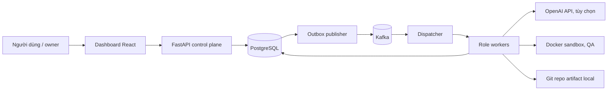
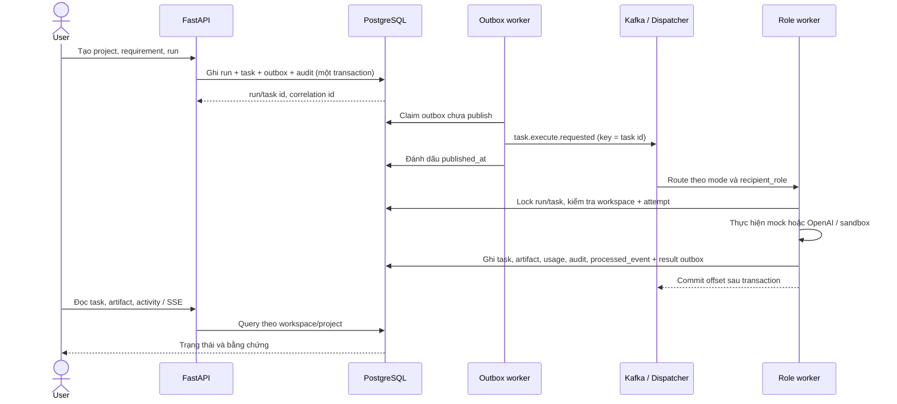
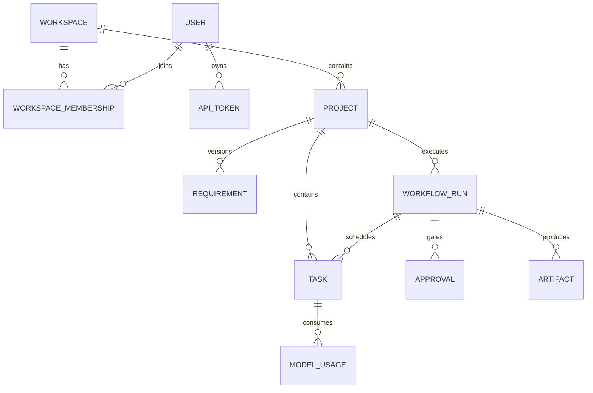

# Kiến trúc W2 — bản để duyệt

**Trạng thái:** Draft. Mô tả prototype tại `main` ngày 29/10/2026; các mục đích v1.0 được ghi riêng. Chưa đạt Gate W2.

## Context và ranh giới

Người dùng duyệt scope và handover qua API. Bootstrap key hoặc token thành viên xác thực vào một workspace cấu hình; API kiểm tra role và workspace trước khi đọc/ghi. Model provider, Docker và Git workspace là các ranh giới có side effect. Chế độ mock không gọi model, không chạy code sinh và không tạo PR.

### Container và quyền sở hữu state

| Thành phần | Hiện có | Giới hạn / mục tiêu |
|---|---|---|
| Dashboard | Project, requirement, run, approval, audit SSE | Chưa có conversation, WebSocket hai chiều |
| API | RBAC local, CRUD, approval và budget | Chưa có OIDC; key bootstrap là owner của workspace cấu hình |
| PostgreSQL | Nguồn business state, outbox, processed event, audit, artifact | Cần backup/restore và lease chính thức |
| Kafka | Vận chuyển command/result theo role | At-least-once; không là nguồn trạng thái nghiệp vụ |
| Workers | Mock hoặc PM → Architect → Developer → QA OpenAI | Retry/cancel còn giới hạn; chưa có worktree repo người dùng |
| Sandbox | Container QA không mạng cho code sinh | Chưa đủ hardening cho tenant không tin cậy |

Trong API, `main.py` quản lý auth, workspace scope, project/run/approval và các route đọc. `services/workflow.py` tạo task cùng outbox event trong một transaction. `outbox_worker.py` publish command, `dispatcher_worker.py` route theo mode/role, `agent_worker.py` hoặc `ai_worker.py` cập nhật task/result. `recovery_worker.py` quét task OpenAI `running` quá 10 phút để retry tối đa ba attempt. LangGraph checkpoint chỉ có trong demo riêng; chưa nối vào run production.

## Một task từ request đến kết quả

Với run mock, scope approval có trước task Developer; sau QA có handover approval. Với run OpenAI, PM tạo PRD rồi chờ scope approval, sau đó Architect, Developer và QA chạy nối tiếp. `correlation_id` theo task và `event_id`/`causation_id` nối command với result. Có thể truy từ `WorkflowRun.id` → `Task.run_id` → `OutboxEvent.payload.task_id` → `ProcessedEvent.event_id` và `AuditLog.correlation_id`; log hiện chưa cung cấp trace end-to-end chuẩn OpenTelemetry.

Publisher có thể gửi Kafka thành công nhưng crash trước `published_at`, nên command sẽ lặp. Consumer dùng `(consumer_name, event_id)` và khóa task để tránh cập nhật business state lặp. Side effect ngoài DB (model call, file, Git, sandbox) vẫn cần fencing theo `execution_id`/attempt; đây là lỗ hổng thiết kế chưa đóng. Xem [event contracts](event-contracts.md) và [ADR-002](ADR-002-kafka-outbox.md).

## ERD mức domain

`Task.run_id` có thể null cho task tạo trực tiếp; `Artifact.run_id` cũng có thể null. `AuditLog` tham chiếu workspace/project bằng ID để giữ lịch sử. `OutboxEvent` và `ProcessedEvent` không có foreign key vào task vì phục vụ delivery/idempotency; payload chứa ID và schema version. Migration hiện tại là nguồn chi tiết cho cột và constraint.

## Quyết định cần chốt ở Gate W2

1. Business state chỉ ở PostgreSQL; xác nhận API/worker nào được phép chuyển từng trạng thái và cách kiểm tra transition.
2. Thiết kế lease/heartbeat/fencing để worker cũ không thể ghi sau attempt mới, kể cả side effect file/Git.
3. Retry/backoff, DLQ, replay và reconciliation cho result outbox; phân biệt lỗi tạm thời với event không hợp lệ.
4. Chính sách provider và dữ liệu được gửi tới model; secret scanning, sandbox isolation và approval trước hành động rủi ro.
5. Tracing và evidence cho hai demo để chứng minh toàn bộ sequence trên staging.

Tài liệu này cần owner/tech reviewer duyệt cùng [threat model](threat-model.md), [test strategy](../testing/test-strategy.md) và wireframes trước khi đánh dấu Gate W2.
